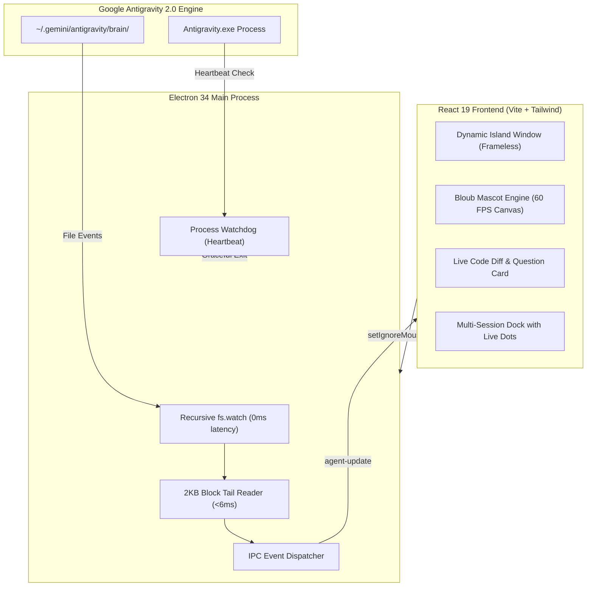

# 🪐 Antigravity Island

<div align="center">


**A sleek, native Dynamic Apple Notch companion for Windows, purpose-built for Google Antigravity 2.0.**

*Monitor your autonomous AI agents, inspect live code diffs, track multi-session chats, and approve actions in real time without leaving your flow.*

[Download Portable .exe](https://github.com/julzburz/antigravity-island/releases) • [Features](#-key-features) • [Quick Start](#-quick-start) • [Architecture](#-architecture) • [Keyboard Shortcuts](#-keyboard-shortcuts)

</div>

---

## 📖 Overview

**Antigravity Island** transforms your Google Antigravity 2.0 pair-programming experience into an intuitive, ambient HUD. Inspired by the Apple Dynamic Island and macOS notch companions, it anchors unobtrusively at the top-center of your primary display.

While collapsed, it occupies just 34px of screen height and is **completely transparent to mouse clicks** (*click-through*), meaning you can click right through it to tabs, editor menus, or browser toolbars with zero friction. When your Antigravity agent starts reasoning, writing code, executing bash commands, or waiting for permissions, the island springs to life with real-time indicators, live diff previews, and an interactive mascot powered by the official **Bloub engine**.

---

## ✨ Key Features

### 🏝️ Dynamic Apple Notch HUD
- **Always on Top:** Snapped cleanly to the top-center border of your primary display.
- **Native Click-Through:** Passes all mouse events through to the background when collapsed. Zero disruption to your daily workflow.
- **Elastic Spring Physics:** Powered by **Framer Motion**, expanding effortlessly into a glassmorphic dashboard on hover or click.
- **Auto-Dismiss & Collapse:** Automatically folds away on mouse leave, on `Esc` keypress, or when clicking outside. Clears completed turn indicators on collapse.

### 👁️ Living Mascot (Official Bloub Bot Engine)
- **Smooth 60 FPS Canvas:** Authentic vector geometry, procedural eye blinking, and organic breathing animations.
- **Cursor Gaze Tracking:** Pupils follow your cursor across the entire screen in real time with cinematic smoothing.
- **State-Reactive Animations:**
  - 🌀 **Orbit / Concentrating:** Active during model reasoning and planning.
  - ⚡ **Alert / Energetic:** Active during tool execution, file editing, and terminal commands.
  - 😉 **Wink / Celebration:** Fires when a turn completes successfully.
  - ❗ **Exclamation Alert:** Triggers immediately when a user prompt or approval modal requires attention (`ask_question`).
  - 😵 **Swirl / Dizziness Easter Egg:** Rapidly clicking the avatar triggers a dizzy animation before returning to work.
- **Zero Idle CPU Overhead:** Gaze tracking suspends automatically when the mouse is at rest (<4px movement threshold).

### ⚡ Concurrent Multi-Session Live Radar
- **Multi-Chat Awareness:** Unlike single-session companions, Antigravity Island continuously tracks all concurrent conversations in `~/.gemini/antigravity/brain`.
- **Multitasking Pill:** When 2 or more chats are active simultaneously, the compact notch morphs dynamically (e.g. `⚡ 2 chats active`).
- **Individual Radar Beacons:**
  - 🟣 **Purple Ping Radar:** Agent is thinking, analyzing prompts, or drafting plans.
  - 🟢 **Cyan Pulse Radar:** Agent is editing files, viewing code, or running terminal tools.
  - 🟡 **Amber Bounce Radar:** Urgent permission or user decision required.
  - 🟢 **Solid Emerald Dot:** Turn completed.
  - ⚪ **Zinc Dot:** Session idle.
- **Non-Intrusive Inspection:** Click any session pill in the bottom dock to inspect its diffs and logs with a 25-second stream lock so background updates don't jerk the view away.

### 💻 Real-Time Code Preview & Interactive Approval
- **Syntax-Highlighted Diffs:** Displays live file modifications (`+` additions, `-` deletions, terminal commands).
- **Interactive Approval Card:** Review options and approve agent questions (`ask_question`) directly from the notch.
- **Instant "Undo to this Point" Sync:** Automatically catches trajectory rewinds and truncations in Antigravity, rolling back diffs and chat history in 0ms.
- **Procedural Audio Chimes:** Crisp, synthesized Web Audio chime tones on task completions and approvals (zero external audio asset bloat).

### 🔄 Symbiotic Process Lifecycle
- **Unified Launch:** Starts automatically with Antigravity using the bundled silent launcher.
- **Intelligent Watchdog:** Asynchronous background monitor polls `Antigravity.exe` every 4 seconds (<12ms, 0.0001% CPU). When Antigravity closes, Antigravity Island gracefully exits (`app.quit()`) automatically.

---

## 🧭 Complete User Guide & Daily Workflow

### 1. Daily Pair-Programming Flow
1. **Launch:** Start Google Antigravity as usual (from your Desktop shortcut or pinned Start Menu icon). Antigravity Island launches alongside it seamlessly without opening any terminal windows.
2. **Ambient Sleeping:** The compact pill rests at the top-center of your display (34px height) displaying `Antigravity`. In this state, it consumes **0% CPU** and is completely in **Click-Through Mode**: your cursor clicks right through it to background windows, tabs, or editor menus.
3. **Working with the Agent:** As soon as you submit a prompt in any Antigravity conversation, the island springs to life:
   - The Bloub mascot's eyes animate into concentration.
   - The status updates dynamically (`Thinking...` ➔ `Reading...` ➔ `Writing...` ➔ `Done ✓`).
4. **Completion:** When your agent finishes its turn, a gentle musical chime plays, and the notch turns green displaying `Done ✓`.
5. **Dismissal:** Opening and closing the notch (or clicking outside) automatically clears `Done ✓` back to the resting `Antigravity` state.
6. **Closing:** When you finish your workday and close Google Antigravity, the background watchdog detects that `Antigravity.exe` has exited and shuts down Antigravity Island automatically.

---

### 2. Status Indicators & Color Reference

The compact notch and mascot communicate the agent's exact state using standardized colors and beacon animations:

| Status Text | Dot & Beacon | Mascot Animation | Meaning |
|---|---|---|---|
| `Antigravity` | ⚪ Zinc Dot | Relaxed Breathing | **Idle / Sleep:** Waiting for instructions. Zero CPU usage. |
| `Thinking...` | 🟣 Purple Ping Radar | Orbital rings | **Deliberating:** Model is reasoning, analyzing prompts, or drafting plans. |
| `Writing...` | 🟢 Cyan Pulse Radar | Alert eyes | **Modifying Code:** Actively editing or creating files in your project. |
| `Reading...` | 🔵 Blue Pulse Radar | Wide attentive gaze | **Inspecting:** Reading files, workspace directory tree, or logs. |
| `Executing...` | 🟡 Amber Pulse Radar | Alert eyes | **Terminal Command:** Running a shell command (`bash`, PowerShell, npm, etc.). |
| `Working...` | 🟢 Cyan Pulse Radar | Concentrated | **Tool Execution:** Processing subagent steps or custom tools. |
| `Permission Required` | 🟡 Amber Bouncing Beacon | Exclamation point (`!`) | **Approval Blocked:** The model called `ask_question` and requires your decision. |
| `⚡ N chats active` | 🔵 Sky Blue Pulse | Dynamic multitasking | **Concurrent Activity:** 2 or more chats are currently running in parallel. |
| `Done ✓` | 🟢 Solid Emerald Dot | Signature Bloub wink (😉) | **Turn Completed:** All actions finished successfully. |
| `Stopped ⏹` | 🟡 Amber Solid Dot | Wide eyes | **Generation Cancelled:** Turn was halted or edited by the user. |
| `Error ✕` | 🔴 Rose Red Pulse | Exclamation alert | **Tool Error:** A step or command encountered a failure. |

---

### 3. Interacting with the Expanded Dashboard

Click anywhere on the compact pill to expand into the full **Apple Notch HUD**:

- **Left Column (Mascot & Action Checklist):**
  - **Bloub Mascot (68px Canvas):** Interactive companion that tracks your cursor across the screen at 60 FPS. *(Tip: Clicking Bloub repeatedly triggers an amusing swirl dizziness easter egg!)*
  - **Checklist Tracker:** Four step indicators automatically check off as the agent works:
    - 📖 `Read:` Project context and file reading.
    - ✏️ `Edit:` Code writing and patch application.
    - ⚡ `Bash:` Terminal execution and verification.
    - ✓ `Done:` Solution finalized.
- **Right Column (Live Code Diff & Interactive Approval):**
  - **Live Code Previews:** While writing code, displays the active file path, syntax language badge, and real-time syntax-colored diffs (`+` additions, `-` deletions, terminal commands).
  - **Interactive Approval Card:** When Antigravity asks a question, this panel morphs into an interactive modal showing the question and clickable choice buttons. Clicking any option immediately approves the response and resumes agent execution.
  - **Response Viewer:** Once complete, displays a clean summary of the agent's response.
- **Bottom Dock (Sessions & Subagents):**
  - **Subagent Badges:** Real-time badges for invoked subagents (`Research`, `Code`, `Bash`) with live activity pulses.
  - **Multi-Session Tabs:** Displays all recent conversations from `~/.gemini/antigravity/brain`.
  - **Individual Status Dots:** Every session pill has its own radar beacon (purple ping, cyan pulse, amber alert, emerald done).
  - **Focus Lock (25s):** Clicking any session pill switches the dashboard view to inspect that chat's progress without background streams abruptly stealing focus.

---

### 4. Collapsing & Keyboard Shortcuts

You can collapse the notch at any time through multiple intuitive methods:

- **Keyboard:** Press `Esc` to instantly minimize.
- **Click Outside:** Click anywhere outside the notch window.
- **Close Button:** Click the `✕` icon in the top navigation bar.
- **Mouse Leave:** Move your cursor away; the notch folds back after a 2-second grace timeout.
- **Manual Quit:** Press `Ctrl + Q` to close the application cleanly.

---

### 5. Sound & Notification Controls

Antigravity Island features procedural audio chimes synthesized in real-time via the Web Audio API (no external sound files required):
- **Success Chime:** Plays a celebratory ascending major triad when a turn finishes.
- **Mute / Unmute:** Click the **Settings** tab in the notch header to toggle audio effects on or off.

---

### 6. Seamless "Undo to this Point" Support

If you click the native **"Undo to this point"** button inside Google Antigravity to rewind a conversation:
- Antigravity Island immediately catches the trajectory shrinkage (`stats.size < lastFileSize`).
- Any chat messages or code diffs from undone steps are purged instantly from the HUD.
- The notch indicates `↺ Reverted to earlier point` and cleanly resets back to sleep mode, perfectly in sync with Antigravity.

---

## 🏛️ Architecture



---

## 🚀 Quick Start

### Option 1: Standalone Portable `.exe` (Recommended)
1. Go to the **[Releases](https://github.com/julzburz/antigravity-island/releases)** page.
2. Download `Antigravity Island 1.0.0.exe`.
3. Double-click to run! No Node.js, Python, or installation required.

### Option 2: Symbiotic Auto-Launch with Antigravity
To make Antigravity Island start automatically whenever you launch Google Antigravity:
1. Keep `Antigravity Island.exe` in any folder on your machine.
2. Use the included `launch_antigravity.vbs` script (or point your existing Antigravity shortcut to it).
3. The script starts both applications simultaneously without opening any black terminal windows.
4. When you close Antigravity at the end of your session, Antigravity Island detects it and closes itself automatically.


---

## 🛠️ Development & Building from Source

### Prerequisites
- **Windows 10 / 11**
- **Node.js 18+** & **npm**
- **Google Antigravity 2.0**

### 1. Clone & Install
```powershell
git clone https://github.com/julzburz/antigravity-island.git
cd antigravity-island
npm install
```

### 2. Development Mode
Run the React Vite dev server with Electron:
```powershell
npm start
```

### 3. Silent Background Mode
Launch silently without a command prompt window:
```powershell
cscript //nologo run_silent.vbs
```

### 4. Build Windows Executable
Package into standalone binaries using `electron-builder`:
```powershell
# Build standalone Portable .exe
npm run dist:portable

# Build NSIS Setup Installer
npm run dist

# Build unpacked binary folder for instant local testing
npm run dist:dir
```
Packaged binaries will be located in the `release/` directory.

---

## ⌨️ Keyboard Shortcuts & Controls

| Shortcut / Action | Function |
|---|---|
| **Hover Notch** | Previews current agent status and action |
| **Click Notch** | Expands full dashboard and pins window |
| **`Esc`** | Minimizes or collapses dashboard |
| **Click Outside** | Collapses notch and clears "Listo ✓" status |
| **`Ctrl + Q`** | Cleanly exits Antigravity Island |
| **System Tray Icon** | Right-click to Center Window, Toggle Visibility, or Exit |

---

## 📂 Project Structure

```
antigravity-island/
├── .github/
│   └── workflows/
│       └── release.yml        # Automated GitHub Release CI/CD
├── build/
│   ├── icon.ico               # Windows multi-resolution icon (256x256)
│   └── icon.png               # High-res icon asset
├── electron/
│   ├── main.cjs               # Main process, fs.watch, watchdog, IPC
│   ├── preload.cjs            # Context bridge APIs
│   ├── icon.png               # Window and tray icon
│   └── tray-icon.png          # System tray icon
├── scripts/
│   └── generate_icon.js       # Procedural PNG/ICO generator
├── src/
│   ├── bot/                   # Official Bloub bot engine & kinematics
│   ├── components/
│   │   ├── ActionChecklist.tsx  # Checklist step tracker
│   │   ├── ApprovalCard.tsx     # Interactive question & decision modal
│   │   ├── CircularPet.tsx      # Mascot Canvas component
│   │   ├── CodePreviewCard.tsx  # Syntax diff and file previewer
│   │   ├── NotchHeader.tsx      # Navigation and sound toggles
│   │   └── SubagentPills.tsx    # Multi-session dock with radar beacons
│   ├── App.tsx                # Dynamic Island HUD container & state
│   ├── main.tsx               # React DOM entrypoint
│   └── index.css              # Obsidian glassmorphic styling
├── launch_antigravity.vbs     # Symbiotic unified silent launcher
├── package.json               # Scripts and electron-builder spec
├── tailwind.config.js         # Tailwind configuration
└── vite.config.ts             # Vite configuration
```

---

## 🤝 Contributing

Contributions, feature requests, and suggestions are welcome!
1. Fork the project (`https://github.com/julzburz/antigravity-island/fork`).
2. Create your feature branch (`git checkout -b feat/amazing-feature`).
3. Commit your changes (`git commit -m 'feat: add amazing feature'`).
4. Push to the branch (`git push origin feat/amazing-feature`).
5. Open a Pull Request.

---

## 📄 License

Distributed under the **MIT License**. See [`LICENSE`](LICENSE) for more information.

---

<div align="center">

Crafted with care by [julzburz](https://github.com/julzburz) for the **Google Antigravity** community.

</div>
